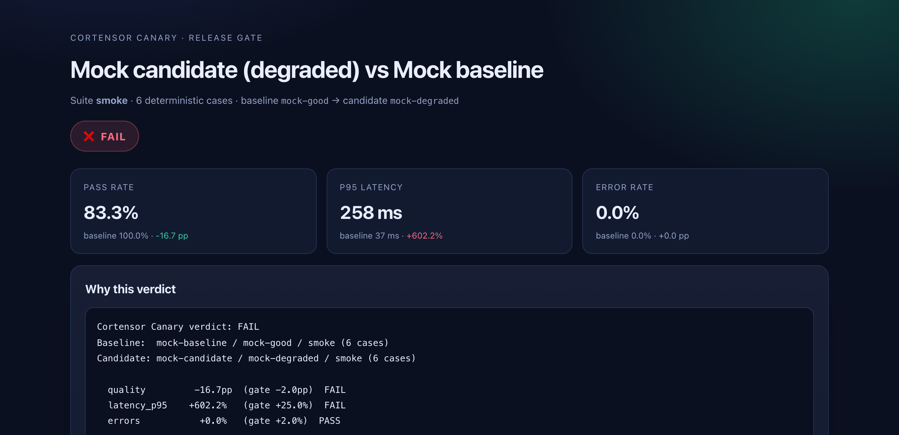
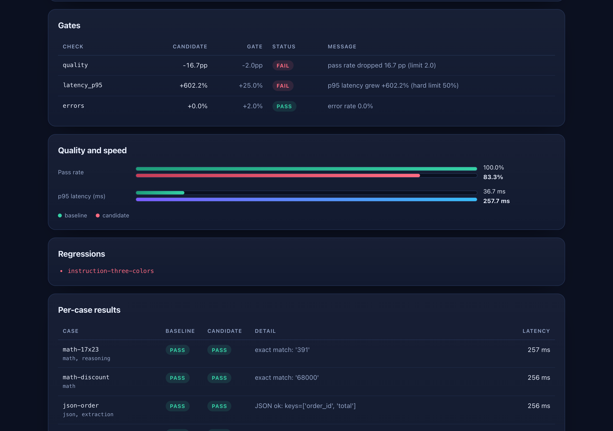
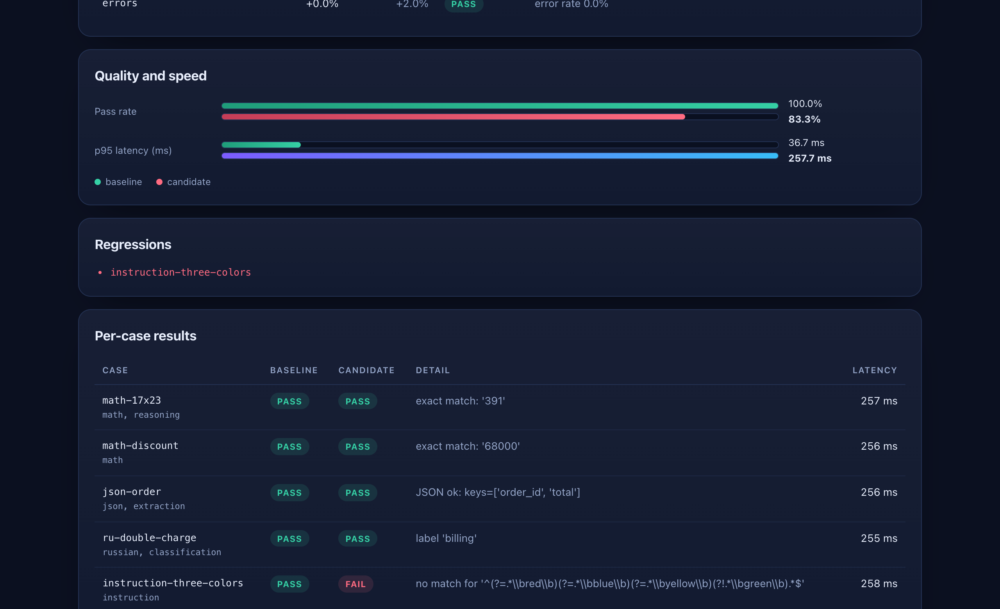

# Cortensor Canary

[](https://github.com/9xj89gzrtw-hue/cortensor-openminion-agent/actions/workflows/ci.yml)


**A release gate for LLM endpoints.** Run your own task suite against the endpoint you use today and
against a candidate (Cortensor Portal, a local Cortensor Router, Ollama, vLLM, anything
OpenAI-compatible), then get a deterministic **PASS / WARN / FAIL** verdict with the failing cases
named explicitly.

> Models get swapped in a Slack message. Nobody measures whether the replacement is worse.
> Canary makes that measurement a 30-second command instead of a two-week argument.

`demo` always exits 0 — it demonstrates a failing gate. The real commands (`canary`, `compare`) exit `1`
on FAIL, which is what CI consumes.

<!-- Screenshots live in artifacts/demo/ and are produced by scripts/screenshots.mjs -->


**65-second demo video** — [`artifacts/demo/demo.mp4`](artifacts/demo/demo.mp4): a real run, recorded from a pty
(`scripts/make_demo_video.py`), showing `version → suites → targets → demo --agent → 65 tests → the generated
HTML report`. Terminal replay is slowed to 0.65× for readability; every number in it comes from that run.

## Why this exists

Moving inference to a decentralized network (Cortensor) or to a cheaper provider is a **release**,
not a config change. It can silently break JSON output, Russian intent classification, or latency.
Prompt-level spot checks do not catch that, and LLM-as-judge scoring is not reproducible enough to
gate a deploy.

Canary is built on three rules:

1. **Every number comes from a tool call.** No model in the loop ever reports a metric it did not read.
2. **Scoring is deterministic.** `exact`, `contains`, `regex`, `label`, `json`. Same input, same verdict.
3. **The gate is explicit.** Quality drop, p95 latency growth and error rate each have a threshold you set.

## Quick start

No dependencies beyond Python 3.9+. No `pip install`, no database, no Docker needed for the demo.

```bash
git clone https://github.com/9xj89gzrtw-hue/cortensor-openminion-agent.git
cd cortensor-openminion-agent

./canary version          # version + whether OpenMinion is available
./canary suites           # bundled suites
./canary targets          # configured endpoints

./canary demo             # full offline gate: mock baseline vs degraded candidate
```

`demo` starts two local mock endpoints, runs the `smoke` suite against both, applies the gates and
writes JSON + Markdown + HTML reports. The candidate fails, so the verdict is FAIL:

```text
                    baseline     candidate       delta
  pass rate           100.0%         83.3%      -16.7pp
  p95                  36.7ms       257.7ms     +602.2%
  errors                   0             0

Cortensor Canary verdict: FAIL
...
  quality         -16.7pp  (gate -2.0pp)  FAIL
  latency_p95    +602.2%   (gate +25.0%)  FAIL
  errors           +0.0%   (gate +2.0%)  PASS

Regressions: 1 -> instruction-three-colors
Report: artifacts/demo/reports/20261028T113944Z-smoke/report.html
```

Those numbers are **fixture data from the bundled mock**, not a benchmark of Cortensor. They exist
so the pipeline is testable offline; the degraded profile deliberately answers one instruction case wrong.

## Run a real gate

```bash
cp .env.example .env
# put your Cortensor key in .env, then:
export CORTENSOR_API_KEY=...

./canary targets --probe           # one small live request per endpoint
./canary canary \
  --baseline local \
  --candidate portal \
  --suite support-ru
```

Exit code is `0` for PASS/WARN and `1` for FAIL, so it drops straight into CI:

```yaml
- name: Inference release gate
  run: ./canary canary --baseline current --candidate cortensor --suite support-ru
  env:
    CORTENSOR_API_KEY: ${{ secrets.CORTENSOR_API_KEY }}
    OPENAI_API_KEY: ${{ secrets.OPENAI_API_KEY }}
```

### Commands

| Command | What it does |
|---|---|
| `canary targets [--probe]` | List endpoints; `--probe` sends one tiny live request each |
| `canary suites` | List bundled suites and case counts |
| `canary run --target X --suite Y` | Run one suite against one endpoint, save the run artifact |
| `canary compare A B` | Compare two saved runs, write reports, exit 1 on FAIL |
| `canary canary --baseline A --candidate B` | Run both and gate in one shot |
| `canary demo [--agent]` | Offline end-to-end demo (mock endpoints) |
| `canary agent "<objective>"` | Drive the gate through the OpenMinion agent |
| `canary version` | Version and OpenMinion availability |

### Gate thresholds

| Flag | Default | Meaning |
|---|---|---|
| `--max-quality-drop` | `2.0` pp | Allowed pass-rate drop vs baseline |
| `--max-latency-increase` | `25.0` % | p95 growth that triggers WARN; 2× that is FAIL |
| `--max-error-rate` | `2.0` % | Candidate error rate that triggers FAIL |

## Bundled suites

| Suite | Cases | What it covers |
|---|---:|---|
| `smoke` | 6 | Arithmetic, discount math, JSON extraction, Russian intent label, instruction following, world knowledge |
| `support-ru` | 9 | Russian support triage: 6 intent labels + order-id extraction + intent JSON |
| `structured` | 5 | JSON-only generation: sentiment, invoice fields, tool arguments, arrays, escalation flag |

Suites are plain JSON, so a team can commit its own workload:

```json
{
  "name": "my-support",
  "version": "1.0",
  "default_max_tokens": 128,
  "cases": [
    {
      "id": "refund-intent",
      "prompt": "Классифицируй: «Верните деньги за разбитый товар». Ответь меткой: billing, tech, refund, other.",
      "max_tokens": 16,
      "expect": {"type": "label", "value": ["billing", "tech", "refund", "other"]}
    }
  ]
}
```

Expectation types: `exact`, `contains` (`mode: all|any`), `regex`, `label` (rejects ambiguous answers),
`json` (`keys`, `equals`, `unordered`).

## OpenMinion agent

The gate is also an agent. `canary agent` runs an OpenMinion `Agent` whose tools wrap the deterministic
runner:

```text
list_targets → run_eval(baseline) → run_eval(candidate) → compare_runs → gate_verdict
```

The model plans the sequence and explains the result; it cannot invent a pass rate, because the only
numbers it can see come back from those tool calls. Tools are declared `READ_ONLY`, so the loop runs
without interactive approval prompts.

```bash
python3.11 -m venv .venv && source .venv/bin/activate
pip install 'openminion>=0.1.14'
openminion setup --provider cortensor-portal --model oss-20b --no-chat   # writes ~/.openminion/agents.json
export CORTENSOR_API_KEY=...

./canary agent "Can the Cortensor portal replace my local Ollama for the support-ru suite?"
```

Offline agent demo (no key, no network — the mock also scripts the tool loop):

```bash
CANARY_MOCK_KEY=mock ./canary demo --agent
# ... [agent] inference steps: 9, tool calls: 5, tool errors: 0, tokens: 5189
```

If `openminion` lives in a different interpreter than the one the wrapper picks, point it there:

```bash
PYTHON=python3.11 ./canary agent "Can Cortensor replace my baseline for support-ru?"
```

OpenMinion ships native `cortensor-portal` and `cortensor-router` presets, so no custom adapter is required.



### Per-case evidence

Every case keeps its prompt, answer, score and latency, so a regression is a named case and a diff —
not an opinion.



## What you get in `artifacts/`

```
artifacts/
├── runs/<run-id>.json           # every case: prompt, answer, score, latency, tokens
└── reports/<timestamp>-<suite>/
    ├── comparison.json          # machine-readable verdict + deltas + regressions
    ├── report.md                # for PR comments
    └── report.html              # self-contained, no JS, prints cleanly
```

## Architecture

```text
suites/*.json ──► runner ──► runs/*.json ──► compare ──► PASS / WARN / FAIL
                     │                          │
              OpenAI-compatible client     report.md + report.html
                     │                          │
        Cortensor / Router / Ollama      OpenMinion agent tools
```

- **Standard library only** for the core: `urllib`, `json`, `sqlite`-free, no SDKs. The canary has to
  run in a bare CI container.
- **Retries** on 408/409/425/429/5xx with exponential backoff; latency measured per attempt.
- **Token accounting** from the provider response, with a `len/4` estimate as a fallback.
- **Secrets never leave the process**: only `api_key_env` names are serialized into artifacts.

More detail in [docs/ARCHITECTURE.md](docs/ARCHITECTURE.md).

## Development

```bash
make test          # 65 tests, no network required
make demo          # offline end-to-end gate
make demo-agent    # + OpenMinion agent loop (needs openminion installed)
make lint          # compileall + import check
```

Without OpenMinion installed, the two agent tests are skipped and everything else still runs.

```
Ran 65 tests in 24.796s
OK
```

## Limitations, stated honestly

- The bundled suites are **small and synthetic**. They prove the pipeline works; they do not prove a
  provider is good for your workload. Bring your own cases.
- Deterministic scoring cannot judge open-ended prose. That is deliberate: an LLM judge would make the
  gate non-reproducible.
- Latency measured from one machine is not a global latency benchmark. Compare baseline and candidate
  from the same host, in the same run.
- `cortensor-portal` can be slow or unstable; the client retries, but a FAIL caused by timeouts is a
  real signal about release readiness, not a bug in the gate.

## License

Apache-2.0. See [LICENSE](LICENSE).

Русская версия: [README_RU.md](README_RU.md).
